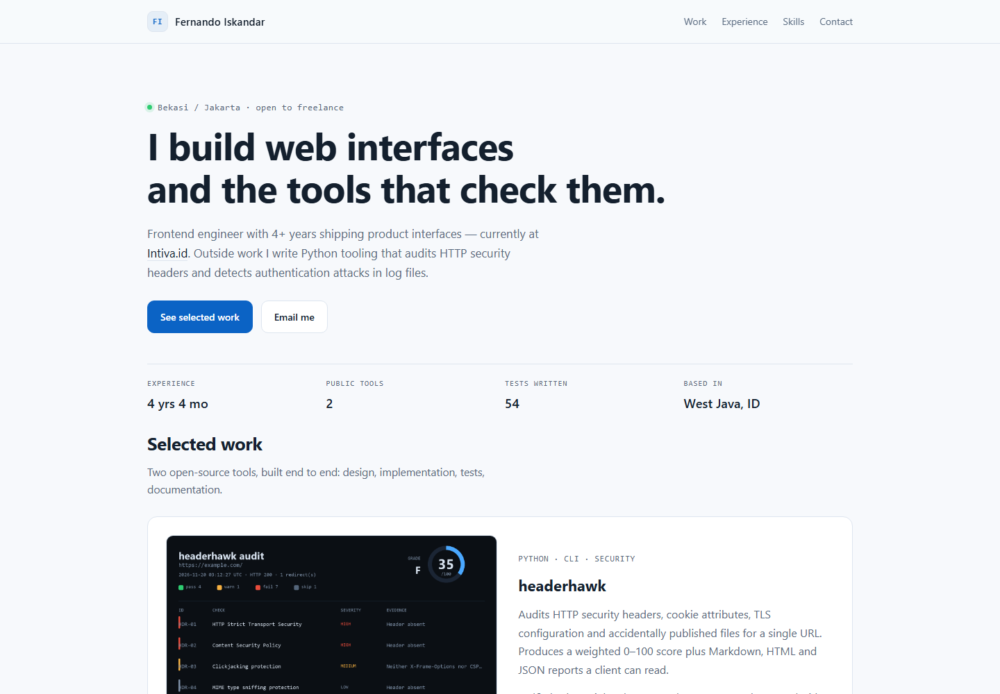

# portfolio-site

Personal portfolio for Fernando Iskandar — frontend engineer and security
tooling. One static page, hand-written HTML and CSS, no framework, no build
step, no trackers, no external requests.

```
index.html          the page
assets/style.css    all styling, dark by default
assets/app.js       current year + nav highlight; the page works without it
assets/*.png        project screenshots (taken from the real repos) + og card
assets/favicon.svg  monogram
tools/make_og.py    regenerates assets/og.png
```



## Local preview

Any static server works:

```bash
python -m http.server 8000
# then open http://localhost:8000
```

## Deploy

GitHub Pages, from the repository root:

1. push this repo (public — Pages needs a public repo on a free account)
2. Settings → Pages → Source: *Deploy from a branch* → branch `main`, folder `/ (root)`
3. site appears at `https://<user>.github.io/portfolio-site/`

If you move to a custom domain, update `sitemap.xml` and `robots.txt`, and add a
`CNAME` file with the domain.

## Editing content

Everything is literal text in `index.html`. The sections are marked with comments
(`<!-- HERO -->`, `<!-- WORK -->`, `<!-- EXPERIENCE -->`, …), so search for the
comment and edit inside it. There is no templating layer to learn.

Content sources used for this first version:

- **Experience** — the public LinkedIn profile (`linkedin.com/in/nandooliauw`)
- **Work** — the two public repositories, `headerhawk` and `loghawk`
- **Certifications** — read from the original certificate images in
  `macbook/Web Portofolio/` (Google Data Analytics, MikroTik MTCNA), then
  re-exported to `assets/cert-*.jpg` at web size
- **Client work** — described by scope only; repositories are private, names withheld

Numbers on the page are real: `4 yrs 4 mo` from the LinkedIn profile, `54` tests
is 31 (headerhawk) + 23 (loghawk), `2` public tools.

## What was verified

- HTML parsed: no missing `alt`, no broken in-page anchors, no missing local
  assets, exactly one `<h1>`, all six sections present
- Served locally and fetched over HTTP: page, CSS, JS, both project images, og
  card, favicon and `robots.txt` all return `200`
- Contrast ratios computed against WCAG AA: body text 15.2:1, secondary text
  7.3:1, accent 7.6:1 on the dark palette; all pass
- One real render captured (`docs/preview-light.png`, light palette)

## Known gaps

- No mobile screenshot was captured — headless Chrome/Edge on this machine
  stopped launching after the first capture. Layout uses a single breakpoint at
  820px and a 2-column stat grid at 620px, but it is unverified visually.
- Dark palette is the default; the light palette exists behind
  `<html data-theme="light">` and is what `docs/preview-light.png` shows.
- No analytics, deliberately. If you want visit counts later, prefer a
  self-hosted counter over a third-party script.

## License

Content and code: MIT.
